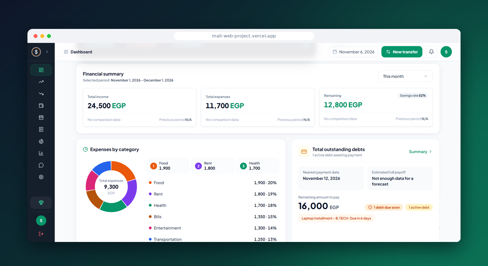
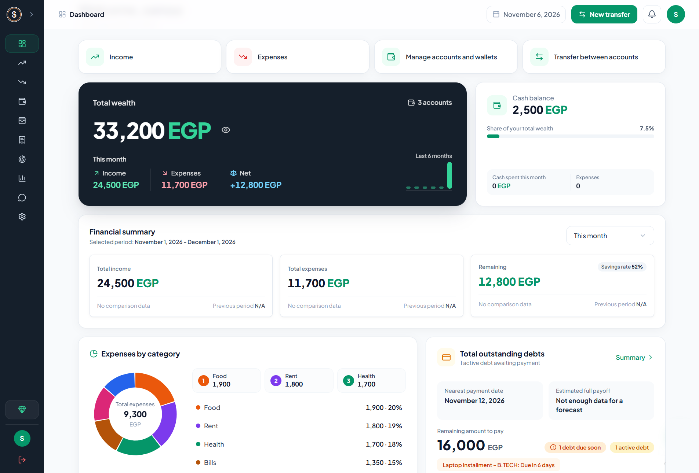
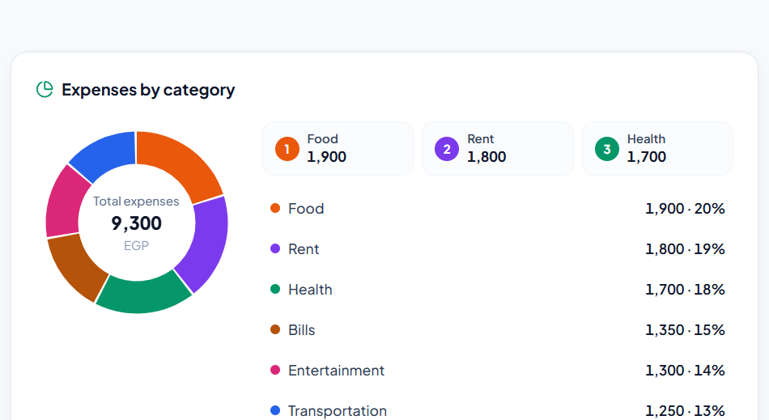
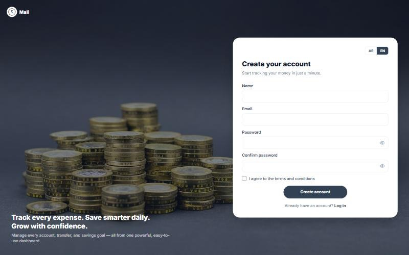

# Mali · مالي

**Personal Finance Tracker — a full-stack web app built by a team of 5 at Habib Academy**

**نظام لإدارة الفلوس الشخصية — اتبنى بفريق من 5 أشخاص في Habib Academy**

[Live Demo](https://mali-web-project.vercel.app/)

---

## About the Project

Mali helps people see where their money goes. Users record income and expenses, manage their accounts and cash, track debts and due dates, and follow everything on a live dashboard.

The app supports Arabic and English, has light and dark themes, and includes an admin panel for managing users.

It was the capstone project of a 3-month front-end training program at Habib Academy (Jul–Oct 2026) that simulated a real company workflow: user stories, task breakdown, pull requests and code review. The backend API was provided by the instructor; the team built the full front-end on top of it.

## المشروع ده إيه؟

مالي بيساعدك تعرف فلوسك بتروح فين. المستخدم بيسجّل الدخل والمصروفات، وبيدير حساباته والكاش، وبيتابع الديون ومواعيد سدادها، وكل ده قدامه على داشبورد بتتحدّث أول بأول.

الموقع بيدعم العربي والإنجليزي، وفيه وضع فاتح وغامق، ولوحة تحكم للأدمن لإدارة المستخدمين.

ده كان مشروع التخرج من تدريب Front-End لمدة 3 شهور في Habib Academy (يوليو–أكتوبر 2026)، والتدريب كان بيحاكي شغل الشركات الحقيقي: User Stories، وتقسيم مهام، وPull Requests، ومراجعة كود. الـ Backend كان جاهز من المدرّب، والفريق بنى الـ Front-End كله عليه.

---

## Screenshots — صور من الموقع

| Dashboard — الداشبورد | Expenses by Category — المصروفات حسب الفئة |
| :---: | :---: |
|  |  |

| Sign Up — إنشاء حساب |
| :---: |
|  |

---

## My Role — دوري في المشروع

I was the **Front-End Team Lead** and also a **developer** on the team.

كنت **قائدة فريق الـ Front-End**، وفي نفس الوقت **مطوّرة** شغّالة مع الفريق.

**As Team Lead — كقائدة فريق**

- Broke down 30+ user stories into tasks and assigned them across the team
- Set up the shared environment: MongoDB database and GitHub repo with team access
- Reviewed every pull request and sent back changes before merge
- Verified all API endpoints and made sure every user story was fully delivered

**As Developer — كمطوّرة**

- Authentication flow (with the team)
- **US-101** Add Income with recurrence and validation
- **US-205** Edit / Delete Expense with automatic account balance sync
- **US-305** Account Transaction History with date filters
- **US-404** Cash Expenses view with filters and totals
- **US-505** Debt due-date alerts with overdue badges

---

## Features — المميزات

| Feature | Description | الميزة |
| --- | --- | --- |
| Dashboard | Total balance, monthly summary and expenses by category | داشبورد بالرصيد والملخص الشهري والمصروفات حسب الفئة |
| Income & Expenses | Add, edit and delete, with recurring entries | إضافة وتعديل وحذف الدخل والمصروفات، مع التكرار |
| Accounts & Cash | Multiple accounts with balances kept in sync | أكتر من حساب، والأرصدة بتتظبط تلقائيًا |
| Transaction History | Per-account history with date filters | سجل العمليات لكل حساب مع فلترة بالتاريخ |
| Debts | Due dates, alerts and overdue badges | الديون ومواعيدها وتنبيهات التأخير |
| Bilingual | Arabic (RTL) and English | عربي وإنجليزي |
| Themes | Light and dark mode | وضع فاتح وغامق |
| Admin Panel | Users, activation / suspension, subscriptions, ads and user–admin chat | إدارة المستخدمين والاشتراكات والإعلانات والشات مع الأدمن |

---

## Tech Stack — التقنيات المستخدمة

| Layer | Technologies |
| --- | --- |
| Frontend — الواجهة | React, Redux Toolkit, React Router, Tailwind CSS, Vite |
| Backend — السيرفر | Node.js, Express, JWT (provided by the instructor) |
| Database — قاعدة البيانات | MongoDB (with transactions for balance changes) |
| Workflow | Git, GitHub pull requests, Postman |

---

Team Lead: **Samaa Abo Diab** · [Portfolio](https://samaa-portfolio21.vercel.app) · [LinkedIn](https://www.linkedin.com/in/samaa-abo-diab)

© All rights reserved.

